  

---

## 👨‍💻 About Me

I'm a **Computer Science & Engineering (AI & ML)** student who enjoys turning ideas into complete, working applications — from database design and REST APIs to clean, responsive user interfaces.

- 🎓 B.Tech in **Computer Science & Engineering (AI & ML)**
- ☕ Backend development with **Java, Spring Boot and REST APIs**
- ⚛️ Frontend development with **React.js, JavaScript and TypeScript**
- 🤖 Exploring **Machine Learning with Python**
- 🗄️ Databases: **MySQL, PostgreSQL and MongoDB**
- 🧩 Strengthening **Data Structures & Algorithms** through consistent practice
- 🚀 Looking for **internship and entry-level opportunities** in full-stack development

---

## 🛠️ Tech Stack

**Languages**

**Frameworks & Libraries**

**Databases**

**Tools & DevOps**

---

## 🚀 Featured Projects

| Project | Description | Tech Stack |
| :-- | :-- | :-- |
| 🎓 [**Campus Connect**](https://github.com/Vinay-ravuri/Campus-Connect) | Platform that brings students and campus activities together in one place. | `Java` `Spring Boot` `React` `MySQL` |
| 🏏 [**CricPredX – IPL Match Winner Prediction**](https://github.com/Vinay-ravuri/CricPredX) | Machine learning model that predicts IPL match winners from historical match data. | `Python` `Pandas` `Scikit-learn` |
| 📄 [**Smart Resume Builder**](https://github.com/Vinay-ravuri/Smart-Resume-Builder) | Web app to create and download professional resumes. | `React` `TypeScript` `Spring Boot` |
| 🐞 [**Issue Tracking & Management System**](https://github.com/Vinay-ravuri/Issue-Tracking-System) | Create, assign and track issues across their full lifecycle. | `Java` `Spring Boot` `MySQL` |
| 📦 [**Omnichannel StockGuard**](https://github.com/Vinay-ravuri/Omnichannel-StockGuard) | Inventory monitoring across sales channels to help prevent stock-outs. | `Java` `Spring Boot` `PostgreSQL` |

---

## 📊 GitHub Stats

 

---

## 📈 Contribution Activity

---

## 🏆 Certifications & Achievements

<!-- Replace with YOUR real certifications. Delete lines that don't apply. -->
- 📜 *Certification name – Issuer (Year)*
- 📜 *Certification name – Issuer (Year)*
- 🏅 *Hackathon / competition / achievement*

---

## 🤝 Connect With Me

  

⭐ *If you like my work, consider starring a repository!* ⭐

